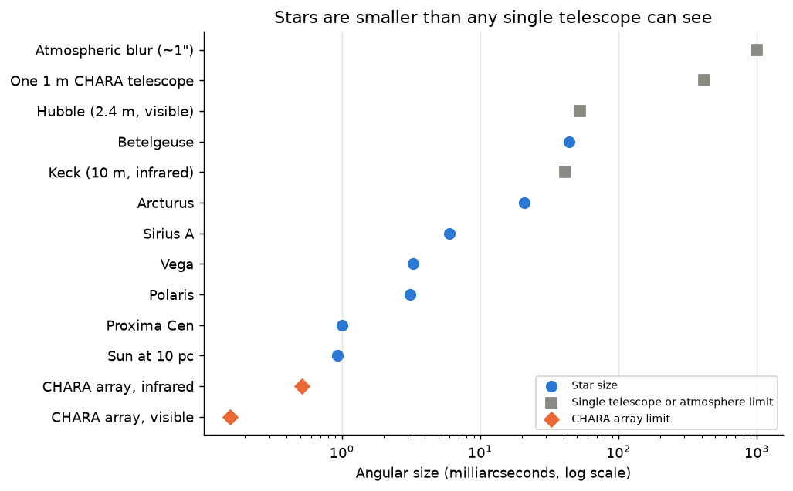
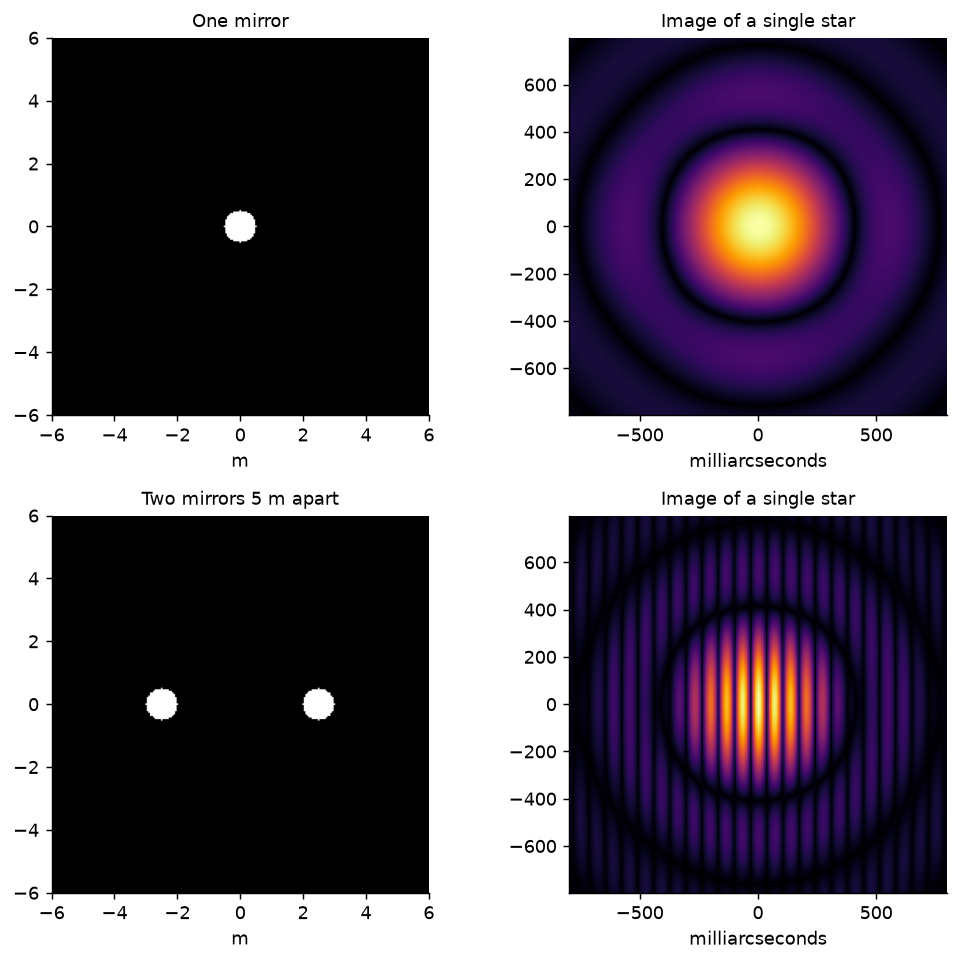
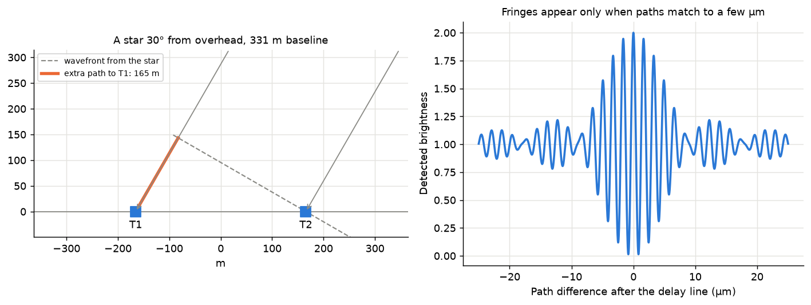
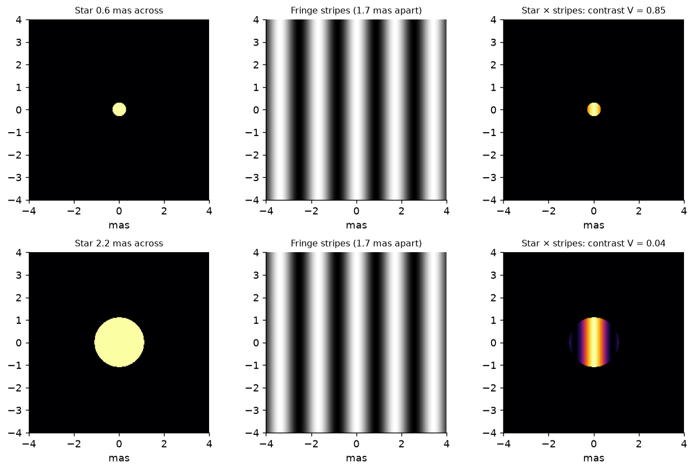
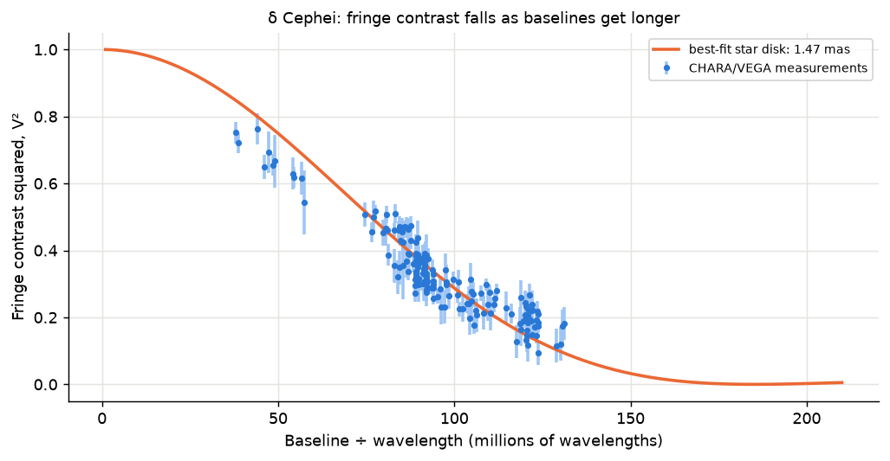
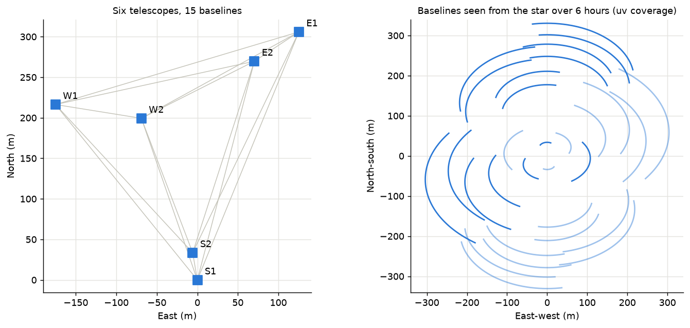
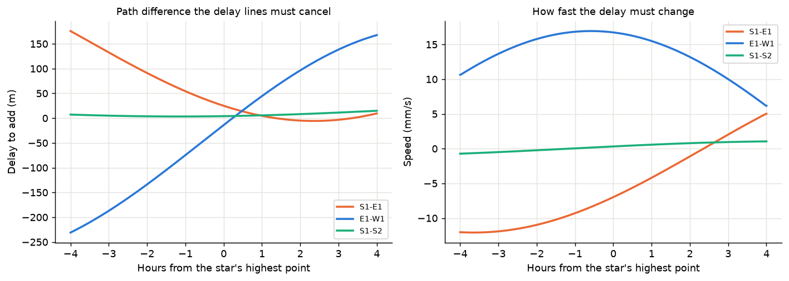
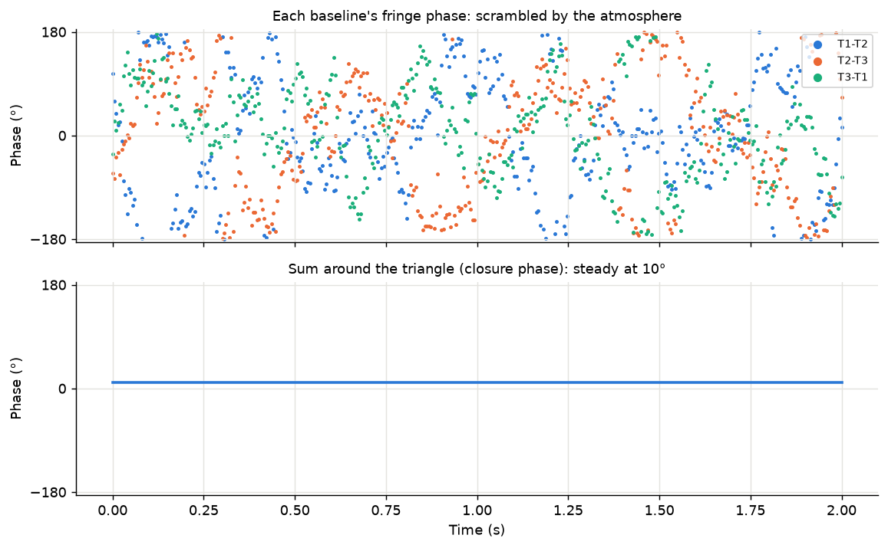
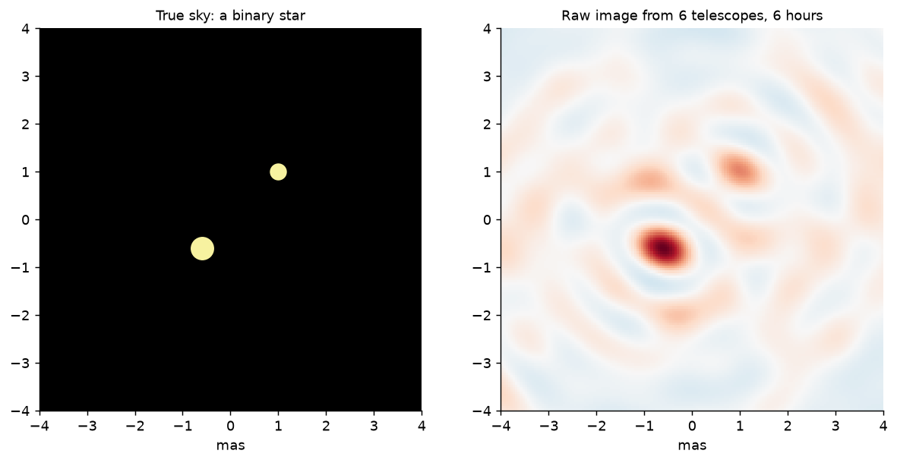

# How the CHARA Array Sees Stars

The CHARA Array sits on Mount Wilson, above Los Angeles, and is run by Georgia State University. It has six telescopes, each with a 1 m mirror. They are spread up to 331 m apart in a Y shape. Light from them is combined to measure details on stars about a thousand times finer than one of its telescopes can see on its own.

This page walks through the physics in eight short steps, one per topic, with one picture each. Each step links to a notebook that covers the topic in depth with interactive sliders.

| Topic | Question | Notebook |
|---|---|---|
| T1 | Why can't one telescope see a star's disk? | [01_diffraction_and_resolution.ipynb](01_diffraction_and_resolution.ipynb) |
| T2 | How does light from two telescopes combine? | [02_two_telescope_interference.ipynb](02_two_telescope_interference.ipynb) |
| T3 | What does a fringe actually measure? | [03_van_cittert_zernike.ipynb](03_van_cittert_zernike.ipynb) |
| T4 | How do you measure a star's size? | [04_stellar_diameters.ipynb](04_stellar_diameters.ipynb) |
| T5 | How do many baselines and Earth's rotation help? | [05_uv_coverage.ipynb](05_uv_coverage.ipynb) |
| T6 | How are the light paths kept matched? | planned |
| T7 | What does the atmosphere do, and how is it beaten? | planned |
| T8 | How do you get images of binaries and star surfaces? | planned |

## 1. Stars are too small for one telescope (T1)

Astronomers measure size on the sky as an angle. Stars are so far away that the useful unit is the **milliarcsecond** (mas), 1/3,600,000 of a degree. Most stars that can be measured are 0.1 to 50 mas across.



Light is a wave, and waves spread out after passing through an opening. A telescope therefore turns every point of light into a small blur. The blur's size is about the wavelength divided by the mirror's diameter. For a 1 m mirror in infrared light that is about 400 mas, hundreds of times larger than most stars. Even the biggest telescopes see stars as points.

The way out is in the picture below. One mirror makes a round blur. Two mirrors set apart make the same blur crossed by fine stripes called **fringes**. The stripe spacing depends on the **distance between the mirrors** (the baseline), not on the size of each mirror. With mirrors 331 m apart, the stripes are about 1 mas apart, as fine as star sizes.



**Key idea:** the separation between telescopes, not their size, sets the finest detail an interferometer can measure.

## 2. Combining light from two telescopes (T2)

Fringes only appear if the light from both telescopes arrives at the combiner **in step**. A star that is not straight overhead reaches one telescope before the other. On CHARA's longest baseline that head start can be over 100 m of extra travel.



Starlight contains a range of wavelengths. Each one makes fringes with a slightly different spacing. They only line up where the two paths are equal, so fringes appear as a short burst a few micrometres wide (right). CHARA must cancel more than 100 m of path difference to within a few micrometres.

**Key idea:** the two light paths must be matched to a precision of microns over distances of hundreds of metres.

## 3. What a fringe measures (T3)

Seen from the sky, each telescope pair lays a pattern of bright and dark stripes across the star. The detector does not take a picture. It records one number: the total starlight that falls on bright stripes. As the stripes slide sideways, that number rises and falls. How strongly it swings is the fringe **contrast**, also called the **visibility**.



A small star fits inside one bright stripe, so it brightens and dims as a whole: high contrast (top). A larger star covers bright and dark stripes at once and they cancel: low contrast (bottom). In mathematical terms, each telescope pair measures one **Fourier component** of the star's image. This is the van Cittert–Zernike theorem. Radio telescopes such as ALMA and the Event Horizon Telescope use the same principle.

**Key idea:** fringe contrast tells you how the star's size compares with the stripe spacing.

## 4. Measuring a star's size (T4)

Longer baselines make finer stripes, so the contrast drops as baselines get longer. How fast it drops tells you the star's size. Fitting a model of a star's disk to the measurements gives its **angular diameter**.



These are real public CHARA measurements of δ Cephei, a pulsating supergiant. The best fit gives a diameter of about 1.47 mas. The star is about 272 parsecs away, so this angle corresponds to a radius about 43 times the Sun's. Stars are also dimmer at their edges (limb darkening), and the fit has to allow for it. Interferometry is one of the few ways to measure a star's size directly rather than infer it from models.

**Key idea:** contrast against baseline gives the angular size. Distance then turns it into a true size.

## 5. Many baselines and Earth's rotation (T5)

One telescope pair measures one stripe pattern, one length and one direction. Six telescopes give 15 pairs. As Earth turns, the star moves across the sky and each pair is seen from a changing angle. Over a night each baseline sweeps along a curve. The pattern of curves is called the **uv coverage**.



The more of this plane is filled, the more complete the information about the star's shape. Stars far north on the sky give round, well-filled tracks. Stars near the celestial equator give flat tracks with gaps.

**Key idea:** more telescopes and more hours fill in more of the star's structure.

## 6. Delay lines (T6)

The path difference from step 2 is not fixed. It changes continuously as Earth rotates. CHARA compensates with **delay lines**: mirrors on carts that roll along rails inside long vacuum pipes, adding exactly the right extra path to each beam. The vacuum matters because air would delay each colour differently.



On the longest baselines the needed delay swings through a few hundred metres in a night, changing at up to about 17 mm per second. The carts must follow that while holding the path to within micrometres.

**Key idea:** delay lines are moving mirrors that keep the two paths equal as the star crosses the sky.

## 7. The atmosphere and closure phase (T7)

Turbulent air above each telescope adds a small random delay that changes many times a second. That shifts the fringes back and forth, so the **position** of each fringe, its phase, is scrambled (top). The contrast survives, which is why the measurements in step 4 use contrast only.



There is a way around it. Take three telescopes and add the three fringe phases around the triangle. Each telescope's random delay appears once with a plus sign and once with a minus sign, so it cancels. The sum, called the **closure phase**, stays steady (bottom) and carries real information about the star's shape.

**Key idea:** combining three telescopes cancels the atmosphere's effect on fringe position.

## 8. Binaries and images (T8)

With many baselines, contrast and closure phase, the measurements can be turned back into a picture. The raw result is blurred by gaps in the coverage (right). Image reconstruction fills those gaps using sensible assumptions, such as brightness never being negative. Simpler sources such as binary stars are often fitted directly with a model.



This is how CHARA has measured the orbits of close binary stars and imaged the surfaces of nearby stars, such as the rapidly spinning, oval-shaped Altair.

**Key idea:** enough baselines and phase information turn fringe measurements into real images.

## The whole chain

One telescope blurs a star into a point. Two telescopes far apart make fringes fine enough to probe it, if their paths are matched to microns by delay lines. The fringe contrast on each baseline is one Fourier component of the star's image. Measuring it on many baselines through the night gives the star's size, its shape, and with closure phase to beat the atmosphere, a picture.

## Running the material

The notebooks use a dedicated Python environment in this folder:

```bash
uv venv .venv && uv pip install -p .venv -r requirements.txt
```

Open a notebook in VS Code or JupyterLab and select `.venv` as the kernel. The figures on this page are made by `make_overview_figures.py`:

```bash
.venv/bin/python make_overview_figures.py
```

Notebook 04 and the δ Cephei figure download public CHARA data from the JMMC Optical Interferometry Database into `data/` on first run.
