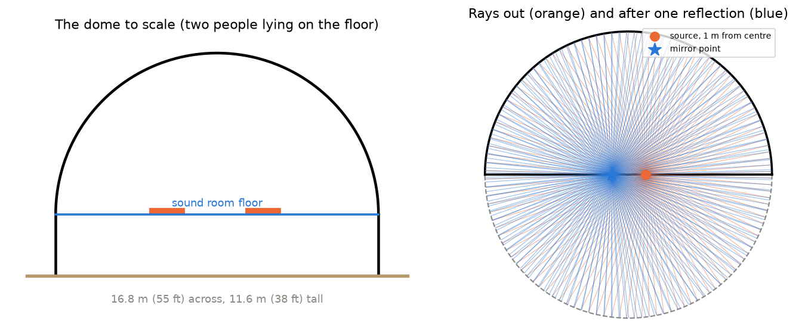
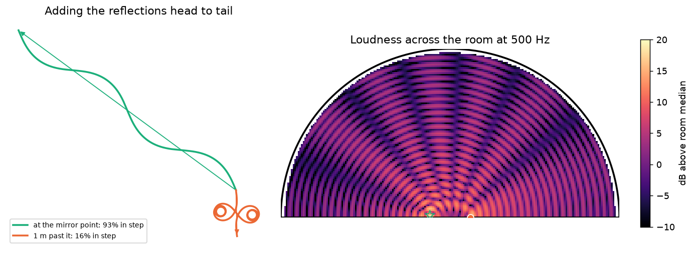
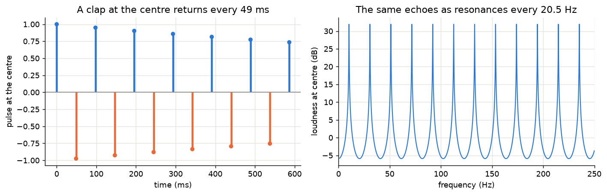
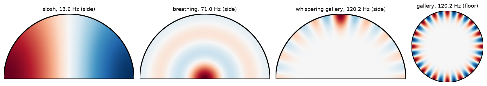
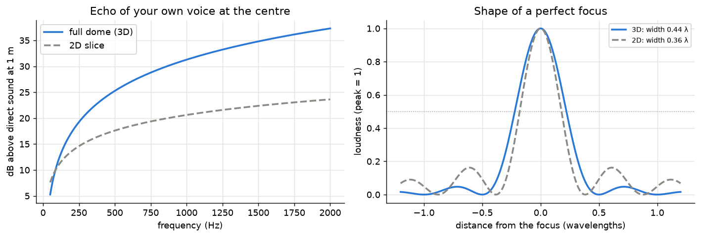
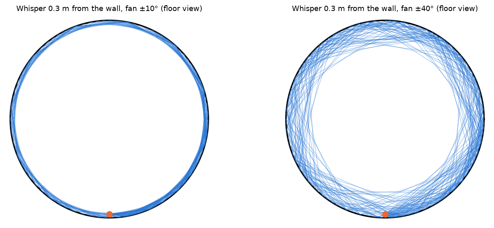
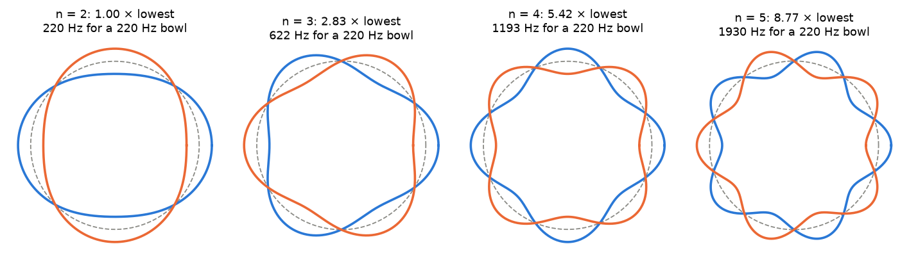
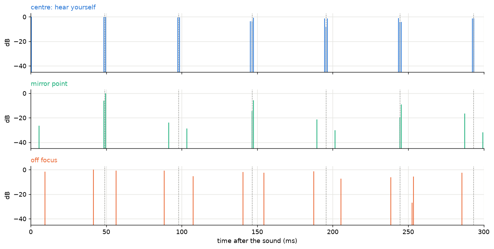

# How the Integratron Sounds

The Integratron is a wooden dome in Landers, California, in the Mojave Desert near Joshua Tree. George Van Tassel built it from the 1950s until his death in 1978. It is 16.8 m (55 ft) across and 11.6 m (38 ft) tall, and today it hosts sound baths in its upper room. Van Tassel's claims about rejuvenation have no evidence behind them. The acoustics are real, and they follow from the shape.

This page walks through the physics in six short steps, one per topic, with one or two pictures each. Each step links to a notebook that covers the topic in depth with interactive sliders and audio.

| Topic | Question | Notebook |
|---|---|---|
| T1 | Where do reflections go, and why is one spot so loud? | [01_dome_reflections_and_focusing.ipynb](01_dome_reflections_and_focusing.ipynb) |
| T2 | Why does the dome keep ringing, and at which notes? | [02_ringing_and_room_modes.ipynb](02_ringing_and_room_modes.ipynb) |
| T3 | How much stronger is the focus when the whole dome takes part? | [03_3d_focusing.ipynb](03_3d_focusing.ipynb) |
| T4 | Why does a whisper cling to the wall? | [04_whispering_gallery.ipynb](04_whispering_gallery.ipynb) |
| T5 | How does a singing bowl vibrate, and how do its notes meet the room? | [05_singing_bowl.ipynb](05_singing_bowl.ipynb) |
| T6 | What does it all sound like at different spots? | [06_listening_to_the_dome.ipynb](06_listening_to_the_dome.ipynb) |

The model throughout is a hard hemisphere of radius 8.4 m on a 3.2 m wall, with the sound room's floor at the base of the hemisphere. Windows, ribs and people are left out unless a notebook says otherwise.

## 1. Reflections focus on a mirror point (T1)

The flat floor reflects sound like a mirror, so sound that bounces off it travels as if it came from a mirror image of the dome below the floor. The dome and its image make a complete sphere, which makes the room much easier to analyse.



A sphere's wall always faces its centre. Sound from a point near the centre reflects and converges on the **mirror point**, the same distance from the centre on the other side (right). A source at the centre gets all its sound straight back to itself. The focus is sharp for sources within about 1 m of the centre. Further out it smears into a curved band called a caustic.

The focus is loud because of **constructive interference**. Every patch of wall sends its own reflected wave to the listener. At the mirror point the paths via every patch are nearly equal in length, so the waves arrive in step and add. One metre away the path lengths differ by several wavelengths, and the waves mostly cancel.



The left plot adds the reflected waves as arrows placed head to tail. At the mirror point they line up into a long chain (93% of the maximum). One metre past it they curl up (16%). The right plot is the resulting loudness map at 500 Hz: the hot spot at the star is 15 to 20 dB above the room's typical level.

**Key idea:** the dome turns any sound near its centre into a focused copy on the opposite side, because the reflections arrive in step there.

## 2. The dome rings (T2)

A clap at the centre travels out, hits the whole wall at the same moment, and returns as one shrinking sphere after $2R/c = 49$ ms. It passes through the centre and repeats, about 20 times a second, losing a few percent at each wall hit.



A regular echo train reinforces notes whose round trip fits the dome and suppresses notes in between. Seen in frequency it is a **comb** of resonances 20.5 Hz apart (right). The longer the echoes last, the sharper each peak.

These resonances are the dome's **modes**, the standing-wave patterns it can hold. Some slosh across the room. Some "breathe" with their peak at the centre. Others cling to the wall: these are **whispering gallery** modes. The hard floor removes half of the patterns a full sphere would have.



With a hard wall absorbing 5% per hit, the room's sound takes about 6 s to fade by 60 dB. Sound launched from the centre takes over twice as long. A perfect sphere also stacks many modes on exactly the same note, so the dome keeps distinct resonances higher up the scale than an ordinary room.

**Key idea:** the echo every 49 ms and the comb of resonances every 20.5 Hz are the same fact, seen in time and in frequency.

## 3. The whole dome focuses (T3)

Notebook 01 works in a vertical slice, which is the same as a long curved wall that focuses in one direction only. The real dome curves in every direction, so sound converges from all sides at once.



Over the whole dome the focus is much stronger. At 500 Hz the reflection at the mirror point is 31 dB above the direct sound, against 20 dB in the slice. Your own voice echoing back at the centre grows 6 dB for each doubling of pitch (left). The hot spot is a round blob about 0.44 wavelengths across: 30 cm at 500 Hz and 16 cm at 1 kHz, smaller than a head. Each ear can then hear a different loudness.

**Key idea:** the full dome makes the hot spot about 10 dB stronger than a slice suggests, and at high pitch it is smaller than your head.

## 4. Whispers cling to the wall (T4)

A reflection off a curved wall cannot change how close a ray passes to the centre. Sound launched almost along the wall therefore stays in a thin band next to it and travels round the room in short hops.



Inside the band the sound spreads over the wall's surface instead of through the room's volume. A quarter of the way round it is about 12 dB louder than sound that crosses the room. One lap of the 52.7 m wall takes 154 ms. On a sphere every path along the wall is a great circle, so gallery sound also refocuses on the wall directly opposite the speaker. A bump on the wall that is a good fraction of the band's thickness breaks the effect.

**Key idea:** a curved wall traps sound launched along it, so a whisper can travel round the room.

## 5. The singing bowl (T5)

A struck singing bowl bends its rim into patterns with 4, 6, 8 and more lobes. Each pattern rings at its own frequency.



The frequencies follow the ratios 1 : 2.83 : 5.42 : 8.77, not whole numbers, so a bowl sounds like a cluster of tones. Small imperfections split each pattern into two close frequencies, which beat: this is the bowl's slow pulse. In the dome, each of the bowl's frequencies lands somewhere on the 20.5 Hz comb, which gives it anything from −6 to +32 dB at the centre. A small change in the bowl's pitch reshuffles which of its frequencies are boosted.

**Key idea:** a bowl's inharmonic frequencies each land differently on the dome's comb, so the room reshapes the bowl's sound.

## 6. Listening (T6)

The last notebook traces 60,000 rays through the dome to compute what a listener at a given spot receives, then plays dry sounds through it.



- **At the centre** you hear your own voice repeated every 49 ms at nearly full strength.
- **At the mirror point** a whisper from 2 m away arrives 27 dB stronger after one reflection than directly, and returns every 98 ms.
- **Off focus**, 2.5 m to the side, the same whisper arrives as a scattered series of echoes, about 22 dB quieter.

The smooth dome rings for about 10 s at 1 kHz. Air absorption takes out the high frequencies first, so the tail grows darker as it fades. A rougher wall that scatters sound weakens the focus and shortens the ringing.

**Key idea:** where you lie in the dome decides whether you hear a focused copy of a sound, a fast flutter of your own voice, or a scattered wash.

## Running the notebooks

```bash
cd integratron
uv venv .venv && uv pip install -p .venv -r requirements.txt
```

Open a notebook in VS Code or JupyterLab and select `integratron/.venv` as the kernel. The figures on this page come from `make_overview_figures.py`.
